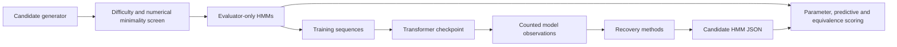

# Architecture

[Documentation](../README.md) · [Design](../research/design.md) · [File map](file-reference.md)

An installable `src/` package holds the research implementation. The CLI is thin;
HMM math, transformer execution, extraction, and evaluation have separate owners.

`process.py` owns node-emission semantics and exact filtering. `model.py` owns causal
transformer execution, BOS handling, checkpoint loading, and observations. `recovery.py`
accepts only a known shape and permitted observations. It does not import or receive
true task parameters, latent labels, or evaluator feedback. `metrics.py` owns alignment,
KL, qualification, rank diagnostics, and supervised probe evaluation. `experiment.py`
connects these pieces and owns split seeds and artifacts.

`sampling.py` screens processes and records every rejection before any training.
`equivalence.py` owns the word-probability comparison and separate complexity measures.
`scaling.py` expands frozen grids and launches one bounded subprocess per case, retaining
failed and unqualified cases. Extractors never receive the private sampling audit.

Public checkpoint payloads contain architecture metadata and tensor weights only.
The private run config contains the generating seed; keep it with the evaluator.
Directories and Python call boundaries do not sandbox untrusted code.

The current extension boundary is a candidate `MixtureHMM` plus its JSON schema.
There is deliberately no general plugin framework. Automata or program generators
should add their own oracle, equivalence relation, and candidate serializer when an
actual experiment needs them; they must not inherit HMM parameter metrics blindly.

The [static website](../../site/README.md) is an explanatory view of published development
results. Its data exporter reproduces known generators from committed audits; the browser
runs a small filter/sampler checked against the Python oracle. It never reads live
experiment directories or calls a model provider. The deployment serves a frozen asset
copy, separate from the working checkout.

`method_study.py` compares the five [method families](../research/method-study.md). Its
public-only extraction function fixes candidate hashes before the outer evaluator opens
truth. `classical.py`, `representations.py`, and `circuits.py` own the method adaptations.
