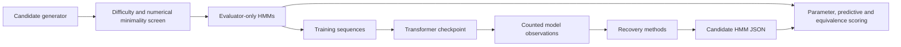

# Architecture

[Documentation](../README.md) · [Design](../research/design.md) · [File map](file-reference.md)

The implemented architecture below is the informed HMM-fitting control pipeline.
The [primary independent-discovery track](../research/independent-discovery.md) has a
[neutral executable runtime](discovery-runtime.md) and [private mixed training suite](../research/mixed-suite.md);
[paired agent development results](../results/agent-development-v2.md) include scoped structural findings, and the [48-trial final campaign](../results/final-campaign-v2.md) is complete. It lets the extractor propose the process family and structure
without inheriting the informed pipeline’s supplied `MixtureHMM` boundary.

An installable `src/` package holds the research implementation. The CLI is thin;
HMM math, transformer execution, extraction, and evaluation have separate owners.

`process.py` owns node-emission semantics and exact filtering. `model.py` owns causal
transformer execution, BOS handling, checkpoint loading, and observations. `recovery.py`
accepts only a known shape and permitted observations. It does not import or receive
true task parameters, latent labels, or evaluator feedback. `metrics.py` owns alignment,
KL, qualification, rank diagnostics, and supervised probe evaluation. `experiment.py`
connects these pieces and owns split seeds and artifacts.

`sampling.py` screens processes and records every rejection before any training.
`equivalence.py` owns the word-probability comparison and separate complexity measures.
`scaling.py` expands frozen grids and launches one bounded subprocess per case, retaining
failed and unqualified cases. Extractors never receive the private sampling audit.

Public checkpoint payloads contain architecture metadata and tensor weights only.
The private run config contains the generating seed; keep it with the evaluator.
Directories and Python call boundaries do not sandbox untrusted code.

The informed-control extension boundary is a candidate `MixtureHMM` plus its JSON schema.
There is deliberately no general plugin framework. The neutral track
uses `SequenceProcess` for private exact oracles and accepts method-chosen executable
representations; program generators do not inherit HMM parameter metrics.

The [static website](../../site/README.md) is an explanatory view of published development
results. Its data exporter reproduces known generators from committed audits; the browser
runs a small filter/sampler checked against the Python oracle. It never reads live
experiment directories or calls a model provider. The deployment serves a frozen asset
copy, separate from the working checkout.

`disclosure.py` labels new artifacts with the supplied family/order and marks
independent discovery as unevaluated. `method_study.py` compares the five informed [method families](../research/method-study.md). Its
public, prior-informed extraction function fixes candidate hashes before the outer evaluator opens
truth. `classical.py`, `representations.py`, and `circuits.py` own the method adaptations.

`challenge.py` exports only declared neural inputs. `submissions.py` freezes arbitrary
mechanism descriptions and Python predictors with an external registration hash.
`isolation.py` and its standalone `isolated_worker.py` run methods with only public
snapshots, then run predictions without the teacher or evaluator files. `discovery.py`
scores frozen executables on equal-length held-out prefixes, separately reporting
teacher fidelity and process fidelity while leaving structural assessment pending.
`discovery_cli.py` owns the neutral export/extract/freeze/score commands.

`neural_numpy.py` provides optional standalone execution of public neural weights
inside the numerical sandbox. It exposes layer traces and counted head/MLP ablations,
with no process-family constructor or supplied fitting adapter. It is extraction
support; a frozen discovered process must run without the original network.

`research_agent.py` connects fresh JSON model calls to that numerical sandbox and
freezes the agent's own chosen program. `agent_client.py` removes native data-access
tools and host context; `agent_preflight.py` audits an actual captured request before
live calls. The trusted authenticated client and networkless numerical code run in
separate namespaces. See the [agent protocol](../research/research-agent.md).

`operator_method.py` packages a restricted classical baseline, estimates observable
moments and selects dimension using public sequence validation. Its standalone
`operator_predictor.py` executes the chosen signed operators without evaluator imports
or a supplied process-family adapter. The first development attempt failed to recover
the mechanisms; it is not an unconstrained family-discovery method.

`generators.py` implements the private HMM, delayed-rule and stack oracles.
`state_geometry.py` learns autonomous linear-state updates from output or activation
coordinates. `operator_structure.py` tests a restricted latent Markov realization
analytically after learning operators, without a supplied fitting template. See
the [method assumptions](../research/state-geometry.md).
`discovery_features.py` adds learned sparse autoencoder/transcoder features and a
greedy head-ablation variant before that same state learner. It records representation
training and neural execution; no supplied HMM adapter or semantic causal claim is added.

`mixed_suite.py` freezes private balanced cases and source snapshots, screens before
training, trains each case in a bounded child, and exports only qualified neural
snapshots. Validation, test and scoring streams remain separate. Longer scoring
archives omit the teacher when the history exceeds its context.

The known-reference exception track has separate owners: `exceptions.py` implements
addition, private point deviations, encoding and ranked set metrics;
`exception_training.py` owns split separation, enrichment, training, specificity checks
and qualified exports; `exception_search.py` brokers isolated searches and verifies
externally registered hashes before private scoring. It reuses the causal transformer,
namespace runtime and neural weight format; it does not route through an HMM adapter.
See [the exception protocol](../research/planted-exceptions.md).

`exception_methods.py` packages standalone NumPy feature/anomaly and intervention searches
that nominate input exceptions. It reuses the existing sparse-feature optimizer and
neural helper, without using their HMM/linear-state fitting adapters.
`exception_method_study.py` freezes methods before fresh training, registers all searches
before private scoring and keeps nominated-unit diagnostics separate from discovery.
